# עריכה ויזואלית

## השפה הוויזואלית של הטיזר

הוויזואל אינו רק כיסוי של קפיצות בעריכת ראיון. הוא מציג את הטיעון כפעולה: עצמאות של סוכן הופכת להעברת כרטיס בנק; צמיחה הופכת למספרים ולגרף; שלושה סרטונים הופכים לשלושה קלפים; עבודה בלילה הופכת לרובוטים מול מחשבים; “זמנם קצוב” מקבל שעון חול; עסקים שלא ישרדו נכבים; והצעה עסקית לא רלוונטית הופכת למכירת קרח באנטארקטיקה. ההמחשה מחליפה תיאור מופשט במצב שאפשר לזהות מהר.

יש כאן שילוב של צילום ראיון, צילום שמוטמע בגרפיקה, ממשקים, איור במראה תלת־ממדי, גוף רובוטי, טקסט מודגש וקומפוזיציות השוואה. אי אפשר לזהות מהקובץ המוגמר באיזו תוכנה נבנו האלמנטים, אם סצנה פוטוריאליסטית נוצרה בכלי AI או באפיק אחר, או אילו easing ו־keyframes היו בקובץ המקורי. ההוראות לשחזור בהמשך הן תרגום של התנועה הנראית לשיטת עבודה, לא גילוי של קוד המקור.

הקובץ: `WhatsApp Video 2026-10-14 at 03.14.18.mp4`, בגודל 576×1024 וב־30fps. אורך הווידאו 65.400 שניות, גוף התוכן עד כ־59.233 וסגירה של כ־6.167 שניות. פריים אחד הוא כ־33.3 מילישניות. אין בו מסלול כתוביות נפרד; הכיתוב שמנותח כאן צרוב בתמונה.

הניתוח מבוסס על פריימים מקוריים לאורך כל הסרטון במרווחי 0.5 שנייה, דגימות של 0.1 שנייה במעברים נבחרים, ושל כל פריים בגליץ ההמרה לרובוט. חיתוכי תמונה הוצלבו עם זיהוי שינוי פריים; זיהוי כזה מציע מועמדים לבדיקה, ואינו יודע להבחין לבדו בין קאט, גליץ, מספר שמתחלף או תאורה שנכבית. התמלול המקומי והכתוביות משמשים להתאמה סמנטית; ההפרדה של מוזיקה, דיבור ואפקטים מהמיקס לא נקבעה מה־ASR.

## מדדים מרכזיים והמשמעות שלהם

| מדד | תוצאה | פירוש נכון |
|---|---:|---|
| גוף התוכן | 59.233 שניות בקירוב | התקציב שבו מתרחשת שרשרת הדיבור וההמחשות |
| מצבי קומפוזיציה שנרשמו בגוף | 28 | כולל שילובים, תקריבי המחשה ושלבי אדם־רובוט; אינו מספר חיתוכי אודיו |
| ממוצע משך מצב | 2.115 שניות | אינו המלצה לחתוך כל שתי שניות |
| חציון משך מצב | 1.500 שניות | חלק ניכר מהמצבים קצרים, ולצדם עוגנים ארוכים |
| המצב הארוך בטבלה | 5.300 שניות | סצנת הקלפים והפרופיל, שבתוכה מתרחשות כמה פעולות |
| ראיון עם כיתוב, ללא המחשה מרכזית נוספת | 20.800 שניות, כ־35.1% | פנים ושאלה יכולים להחזיק זמן בלי בי־רול |
| צילום ראיון המשולב בהמחשה נוספת | 8.833 שניות, כ־14.9% | למשל טלפון, השוואת אדם־רובוט ושעון חול |
| המחשה שמחליפה את תמונת הראיון | 29.600 שניות, כ־50.0% | חלק משמעותי מהסיפור מסופר מחוץ לשוט הדובר |
| גליץ אדם לרובוט שנבדק פריים־פריים | 18.600–18.700, 0.100 שנייה | 3 פריימים מעוותים לפני התייצבות הרובוט |

הסיווג ידני ועקבי בתוך הטבלה: כיתוב רגיל לבדו אינו הופך צילום ראיון ל“מעורב”. תקריב חנות הוא מצב נפרד מהרחוב; גם פנים אנושיות שמתחלפות ברובוט נספרות כמצב חדש. סיווג אחר ייתן ספירת שוטים אחרת. המספרים מתארים את הפירוק הזה ואינם “מדד איכות” אוטומטי.

## פירוק ויזואלי מלא לפי זמן

| זמן | תמונה ופעולה | מנגנון עריכתי | קשר למילים ולמידע |
|---|---|---|---|
| 0.000–1.400 | המרואיין מול וילון כחול, מיקרופון, כיתוב לבן גדול והצגת Max AI | כניסה ישירה לשיחה; אין מסך פתיחה שמפריד מהדיבור | “לאחד הסוכנים שלי” הוא נושא הפתיחה, לא רק כיתוב נלווה |
| 1.400–3.900 | יד אנושית מוסרת כרטיס ליד מכנית; אחר כך מסוף עם אישור ושלט “פתוח” | מעבר מהדובר לדימוי פוטוריאליסטי, ובהמשך שינוי אובייקטים בתוך אותו רעיון | “חשבון בנק”, “שיפתח עסק בעצמו” נהפכים לפעולות בעלות תוצאה נראית |
| 3.900–4.833 | חזרה למרואיין | עוגן קצר של פנים בין המחשות | “העליתי”, “ראיתי” מחזירים את הסיפור לפעולה אישית |
| 4.833–8.800 | מסך טלפון סביב הראיון, לבבות והתראות עוקבים נערמות | צילום מוטמע בממשק; שכבות נכנסות בזו אחר זו | “התפוצץ”, “5,000”, “יומיים שלושה” מקבלים נפח והצטברות |
| 8.800–11.000 | גרף צומח, ערכי צפיות מגיעים ל־800K והמספר מתקרב | הגדלת חשיבות על ידי גדילה מרחבית וכמותית | 800 אלף הם מוקד המסך; אין צורך לקרוא כל שדה קטן בממשק |
| 11.000–11.633 | המרואיין לבדו | הפוגה קצרה מעומס הממשק | גשר “פתאום אני...” לפני תוצאת לפני־ואחרי |
| 11.633–16.933 | שלושה קלפים על רקע ירוק, יד, כרטיס פרופיל, התקרבות ל־24,000 וחשיפת תמונות בקלפים | עולם חזותי אחד שעובר גילוי, מדידה וגילוי נוסף | מספר הסרטונים ומספר העוקבים נעשים אובייקטים שאפשר לספור |
| 16.933–18.400 | המראיין שואל; כיתוב “יותר מוכר” | החלפת תפקיד וקנה מידה שקט יותר | השאלה מתחילה לפני הצגת פתרון ההמחשה |
| 18.400–18.700 | תמונת המרואיין נבחרת כנשא ההמחשה; מופיע AI; גליץ קצר | הכנת מצב אדם והמרתו באותו מיקום | המילה AI מקבלת גוף; המעבר אינו דורש עיצוב של סצנה זרה |
| 18.700–19.700 | גוף רובוטי מתכתי באותו חדר ובאותה תנוחה כללית | שימור זהות קומפוזיציונית עם שינוי החומר והדמות | AI מוגדר כצד אחד של ההשוואה, עם תג AI ברור |
| 19.700–20.600 | חצי אדם וחצי רובוט וקו חלוקה עם ידית | wipe/מסכת השוואה בתוך אותה תמונה | “או סרטון אמיתי?” מקבל שני מועמדים שנראים בו־זמנית |
| 20.600–23.133 | ממשק שתי שורות: אווטאר AI וסרטון אמיתי; ערכים מתעדכנים ותג “מצונזר” | מעבר מרעיון לניסוי מוצג; ערכי המסך הם מוקד התנועה | “שתי קמפיינים”, “ההבדל”; המסך אינו ראיה מספקת להסיק מנצח מספרי בניתוח |
| 23.133–23.867 | חזרה לדובר | מעבר קצר לניסוח האפשרות הבאה | “אני יכול ללכת...” מסמן פעולה חדשה |
| 23.867–28.633 | חלון עם הדובר, לילה ושינה; אחריו רובוטים עובדים מול מחשבים, פסי התקדמות והשתקפויות | פנורמה של עולם אחד; מעבר בין בית לייצור תוך שמירת לילה ופלטה | “לישון”, “סוכנים שלי”, “שיעבדו” הם מצבים שונים באותה שרשרת |
| 28.633–31.067 | הבוקר מחליף את הלילה, והופכים לאחד עד חמישה כרטיסי תוצר | שינוי תאורה כשינוי זמן; הופעה מדורגת ופתיחת מניפה | “בבוקר” ו“עוד חמש כאלה” מתורגמים לזמן ולכמות |
| 31.067–36.033 | שאלה מלאה על אפליקציות; 2026 ואפליקציות מקבלים הדגשה גדולה | עצירה יחסית בתנועת הרקע; הפנים והשאלה מקבלים קדימות | מאפשרים להבין את מושא האיום לפני התשובה |
| 36.033–37.300 | המרואיין על רקע כהה יותר, שעון חול ורוד־אדום, “זמנם קצוב” | בידוד הדמות, החלשת רקע והוספת אובייקט סמלי מעל אזור הגוף | הזמן הופך לאובייקט שנגמר; הצבע מסמן אזהרה |
| 37.300–38.500 | המראיין חוזר על “זמנם קצוב?” | קאט תפקידי ללא מעבר ראוותני | בדיקת העמדה חשובה יותר מעוד אפקט |
| 38.500–41.200 | חזרה לדובר ולשעון; “משוכנע לגמרי” באדום | חזרה לאותה מערכת איום, תוך שינוי הדגשת המילים | התחייבות לעמדה מקבלת משקל ויזואלי עקבי |
| 41.200–45.867 | המראיין שואל על הדרך לעשות כסף עם AI ב־2026 | כיתוב מתפתח בכמה קבוצות; הרקע נשאר צילום ראיון | נותנים לשאלה להיבנות בלי להתחרות בה באמצעות סצנה מלאה |
| 45.867–47.100 | הדובר מחייך ומתחיל “אני אגיד את זה ככה...” | תשובה קצרה שמסמנת הבטחה | ה“ככה...” נשאר גדול וברור ומכין מעבר לשאלה הבאה |
| 47.100–47.667 | המראיין מתחיל שאלת הישרדות | עוגן פנים קצר | מחדד שמדובר בשאלה על בעלי עסקים, לא בנתון חדש |
| 47.667–52.433 | רחוב חנויות בלילה, אור כתום ופסי מצב; “יישארו” ואז “לא יישארו” | שינויי מצב על אותם אובייקטים, צביעה ומעבר מטקסט מלא לקווי מתאר | שימור ושלילה מקבלים תמונה הפוכה; המילה “לא” משנה את העולם |
| 52.433–53.600 | המרואיין מציג את הדימוי | פנים לפני סצנת משל | “אם פתאום...” נותן למסגרת החדשה תנאי והקשר |
| 53.600–55.200 | אותו סוג עולם מסחרי עובר לקרח, פינגווינים וכותרת אנטארקטיקה | מעבר מסביבה מוכרת לסביבה שהופכת את ההצעה למגוחכת | המקום מסביר למה מכירת קרח עלולה להיות מיותרת |
| 55.200–56.000 | תקריב מוכר עם קוביות קרח ושלט כתום | התקרבות לאובייקט הנדון | “אתה תמשיך למכור קרח” מקבל נושא, פועל ומוצר באותה תמונה |
| 56.000–57.700 | חזרה לחנות, האור הכתום ופס המצב נכבים; התרחקות לרחוב | שינוי תוצאה אחרי ההצעה; צילום רחב חושף שהבעיה מערכתית | עסק שממשיך באותו מוצר אינו חסין לשינוי בביקוש |
| 57.700–59.233 | חזרה למרואיין ותחילת ההמשך | הפסקת המשל וחזרה לאדם שנותן קריטריון | הרגע מכוון לעיקרון שטרם הושלם |
| 59.233–61.400 | הראיון הופך לכרטיס נגן, כותרת הפרק וקריאה כתומה לפרק ביוטיוב | מעבר מתוכן לפעולה; האובייקט הקודם מוטמע בכרטיס | ברור לאן עוברים כדי לקבל את ההמשך |
| 61.400–65.400 | כרטיס הסיום מתכהה וידית היוצר מופיעה במרכז | סיום זהות/מיתוג ושהייה | זהו זמן סגירה, לא עוד יחידת טיעון |

הפעולות בתוך שורה אינן בהכרח שוטים נפרדים. לדוגמה, השורה של הקלפים מחזיקה 5.3 שניות ובתוכה החלפת מספר, תקריב וחשיפת שלוש תמונות.

## מנגנוני המושן גרפיקס

### להעביר כוח מאדם למכונה

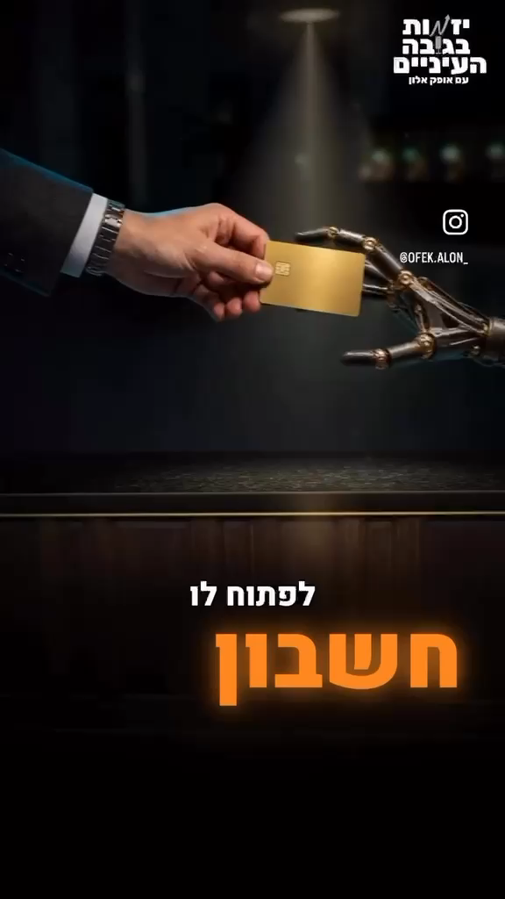

היד האנושית והיד המכנית נמצאות משני צדי הכרטיס. הכרטיס משמש אובייקט מעבר שמובן גם בלי הסבר. המסוף הירוק ושלט “פתוח” מוסיפים תוצאה לפעולה. המהלך בנוי כך: העברה, קבלה, עצמאות עסקית. היד אינה רק “בי־רול של כסף”; היא מציגה את שינוי הסמכות שעליו המשפט מדבר.

בשחזור, שמרו את אותו אובייקט לאורך הפעולה. אל תחליפו את הכרטיס בשטרות, מחשב ומגדל משרדים בשלוש תמונות לא קשורות. צריך להבין מי מוסר, מי מקבל ומה הפעולה מאפשרת.

### להפוך מספר להצטברות ואז למוקד

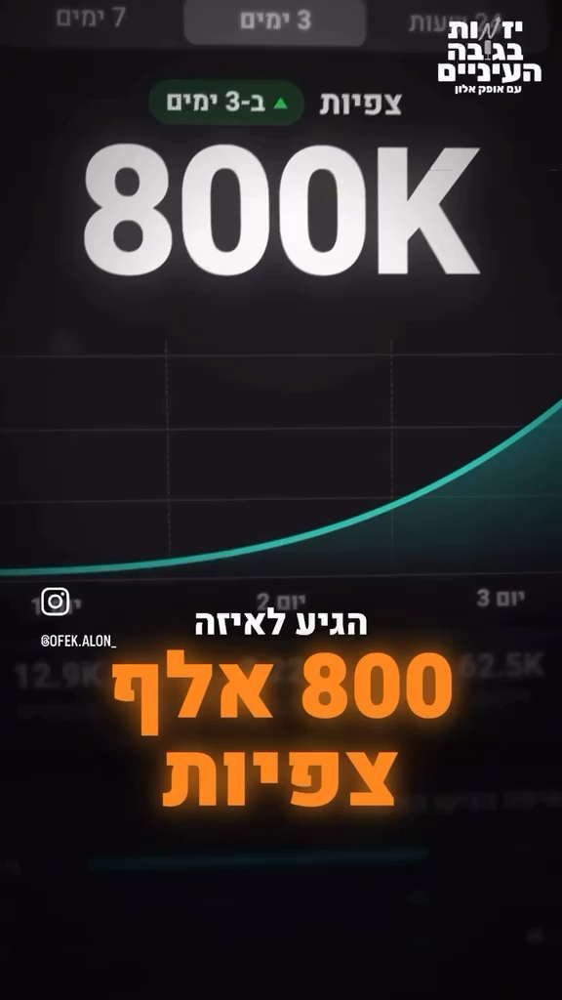

ממשק הטלפון מתחיל בהקשר של העלאת סרטון. הלבבות והתראות העוקבים נכנסים מעל אותו צילום. אחר כך מופיע מדד הצפיות כמסך נפרד והערך 800K גדל במרחב. התנועה עוברת מסימנים רבים של תגובה למספר אחד דומיננטי.

ההיררכיה חשובה: הצופה אינו צריך לקרוא כל התראה. הוא רואה הצטברות, מזהה ערך גדול וקורא את המספר העיקרי. הודעות זעירות הן מרקם, לא ערוץ למסירת עובדה שחייבת להיות מובנת. אם אין מקור מאומת לנתון, גרפיקת ממשק צריכה להיות המחשה מסומנת, ולא צילום “ראיה” שנראה אמיתי.

### קלפים כמספר פעולות, לא כקישוט

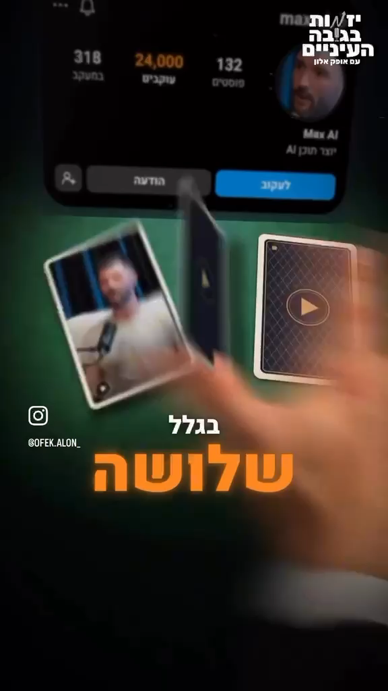

קלפים מאפשרים שלוש פעולות באותה שפה: לספור סרטונים, להסתיר את תוכנם, ולחשוף את פניהם כשהמשפט מגיע לשלושה סרטונים. הפרופיל שמעליהם מספק את ציר לפני־ואחרי. במעבר 9,000→24,000 המוקד אינו דמות חדשה אלא מצב חדש של אותו חשבון. מיקום המספר, ההגדלה והצבע נותנים לו קדימות.

בנייה יעילה שומרת מזהה קבוע לכל קלף: גב, סיבוב ופנים. אל תכניסו שלוש תמונות שונות בלי שלב גילוי כשמנגנון הסקרנות של הקלפים הוא הדבר שרוצים לשמר.

### אדם ורובוט באותה קומפוזיציה

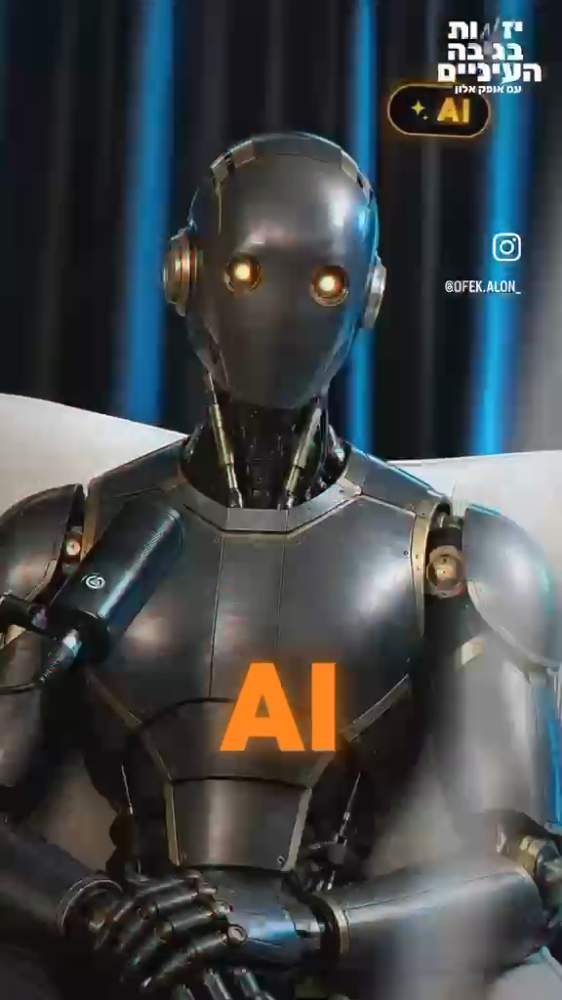

ב־18.500 כבר מופיע AI בכתום, כשהמרואיין עדיין אנושי. ב־18.600, 18.633 ו־18.667 מופיעים פסים ועיוות צבע; ב־18.700 התמונה מתייצבת על רובוט. חלון המעבר הוא 0.100 שנייה: שלושה פריימים מעוותים. הרקע, הכיסא, המיקרופון וכיוון הגוף נשמרים מספיק כדי שהצופה יזהה את ההחלפה במקום לפרש אותה כסצנה חדשה.

זהו גליץ כפסיק רעיוני, ולא אפקט שנמשך לאורך כל המשפט. רוב זמן הצפייה מושקע במצב הברור שאחרי המעבר. יצירת ההמרה עצמה דורשת שכבת גוף/דמות; טקסט “AI” ואפקט צבע לבדם לא משחזרים את המנגנון.

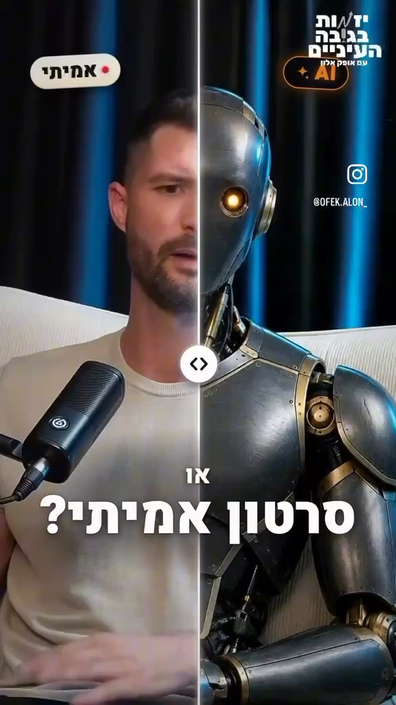

בהמשך קו חשיפה מחזיר חלק מהאדם. לפי דגימות עשירית שנייה, עיקר פעולת החשיפה מתרחש סביב 19.600–19.800, בערך 0.2 שנייה. הידית נעשית סימן לקריאה השוואתית, ואחריה יש זמן לראות את שתי האפשרויות. שוב, התנועה קצרה יותר מהזמן שמוקדש להבנת התמונה.

### ללילה ולבוקר יש תפקיד של שעון סיפורי

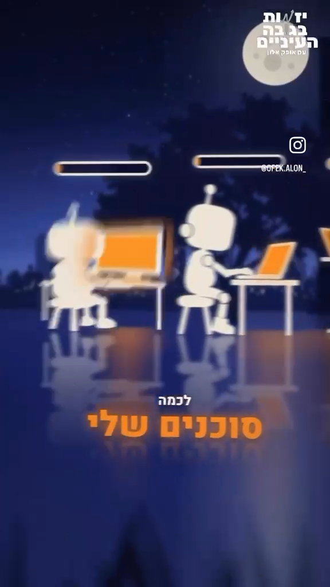

החלון עם הדובר מקשר את העולם המאויר לראיון. השינה, הירח והרובוטים מאפשרים להפריד בין מי שנח למי שעובד. פסי ההתקדמות והמחשבים מגדירים תהליך; השתקפות ברצפה וקני מידה שונים יוצרים עומק.

סביב 28.200–28.500 המבט עובר מהעובדים בחזרה לחלון בתנועה אופקית עם טשטוש. עד כ־28.600 עדיין נראה לילה; ב־28.700 כבר נראה בוקר. זהו שינוי מצב תאורה בתוך מסגרת מוכרת, על “אני אקום בבוקר”. המעבר אינו מצריך משפט נוסף שמסביר שעבר זמן.

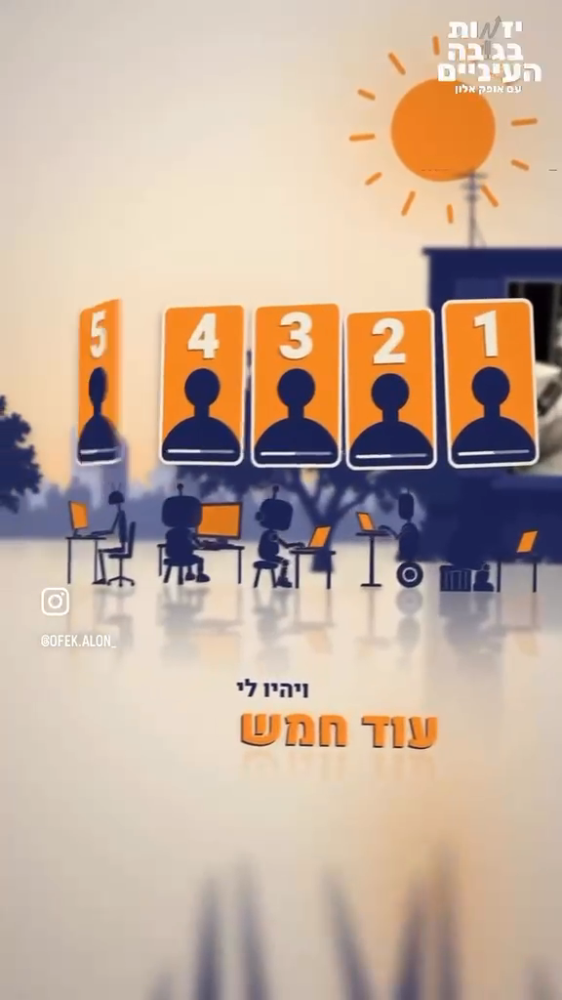

סביב 29.600 מופיע כרטיס ראשון, ועד 30.400 יש חמישה. ארבע תוספות מתפרשות על כ־0.8 שנייה; סדר הגודל הוא תוספת כל 0.2 שנייה, בערך שישה פריימים, עם שונות בין הכניסות. הכרטיסים נפתחים כמניפה מול אותו בית ועובדים. זה ממיר את המילה “חמש” לספירה תוך כדי הופעתה, ולא לנתון שנזרק על רקע ריק.

### זמן קצוב כמצב שנמשך מעבר לקאט

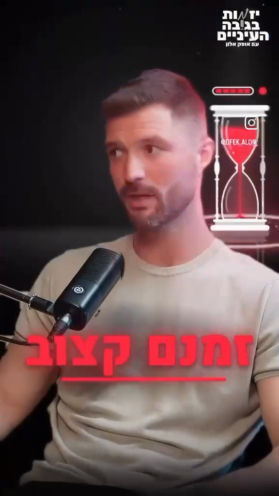

הדובר נשאר מרכז התמונה, הרקע כהה ושעון החול נמצא בצד, מעל אזור הגוף. אדום־ורוד מסמן איום ומחבר “זמנם קצוב” ל“משוכנע לגמרי”. בקאט למראיין נעלמת ההמחשה; בחזרה למרואיין היא חוזרת לאותה מערכת חזותית.

בשחזור כדאי לחשוב על שעון אחד שמייצג מצב מתמשך, לא על אפקט חדש שמתאפס בכל החלפת דובר. אם מוסיפים תנועה לחול או לפס המצב, הזמן שלו צריך להמשיך באופן עקבי גם כשהוא אינו נראה. אין מספיק מידע מהפריימים כדי לטעון לקצב פיזיקלי מסוים של החול או לערך easing מדויק.

### “לא” חייב לשנות את התמונה

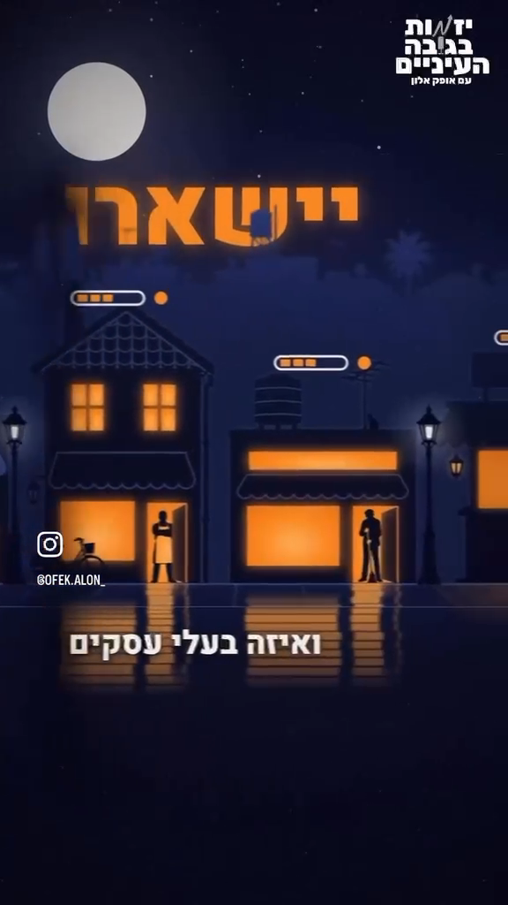

אותן חנויות הן האובייקטים לאורך המשפט. האור הכתום מגדיר פעילות. המילה “יישארו” מקבלת מילוי מודגש; כאשר נכנסת השלילה, חלק מן הצבע והפעילות נעלמים, וטקסט מופיע גם כקווי מתאר. כך השלילה אינה רק מילה בכיתוב אלא פעולה על מצב העולם.

בעריכה חדשה, אילו הצבע היה ממשיך לחגוג כשהדובר אומר “לא יישארו”, ההמחשה הייתה פועלת נגד המשמעות. שלילה, תנאי, השוואה ותוצאה הם טריגרים חזקים יותר לשינוי מצב מאשר שמות עצם אקראיים.

### משל הקרח כשרשרת סיבתית קצרה

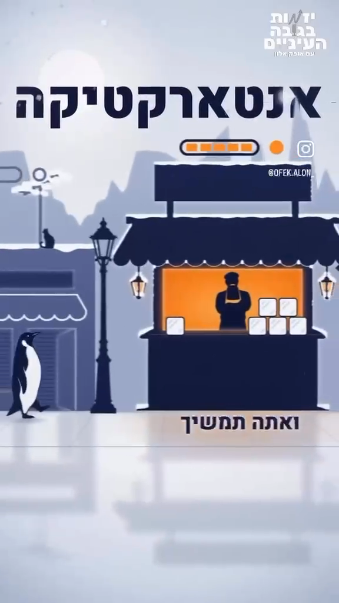

עולם החנויות הקודם חוזר בסביבה קפואה. זה מקטין את עלות ההבנה: מדובר עדיין בעסק, והדבר שהשתנה הוא סביבת הביקוש. הפינגווינים, הקרח והכותרת ממקמים את המשל; הם אינם ראיה לצילום אמיתי מאנטארקטיקה.

התקריב למוכר ולמוצר נעשה סביב 55.200. בהמשך חוזרים לחנות; בין דגימות 56.600 ל־56.700 האור הכתום ופס המצב מתרוקנים/נכבים. ההתרחקות סביב 56.900–57.100 מרחיבה שוב את ההקשר.

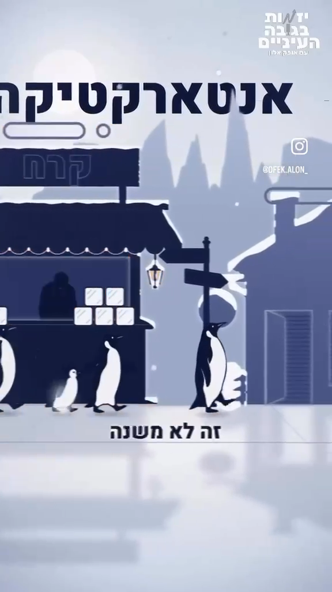

השרשרת היא: מקום עתיר קרח, עסק שמנסה למכור קרח, פעילות שנכבית, מבט רחב על ההשלכה. אילו נעצרה ההמחשה בתמונה של קרח בלבד, הייתה מתקבלת מילת־מפתח יפה, בלי הסבר של הבעיה העסקית.

## משך כניסה, זמן קריאה ומהירות תנועה

יש שלושה שעונים שונים: זמן שבו האובייקט נע לתוך הפריים, זמן שבו המסר יציב וקריא, וזמן המעבר אל המסר הבא. טעות נפוצה היא לתת לכל שלושת השעונים אותה מהירות. ברפרנס הכניסות לעיתים קצרות מאוד, בעוד השאלות או מצבי ההוכחה נשארים יותר זמן.

| אירוע שנבדק | טווח פעולה | זמן משוער | מהירות/צפיפות שאפשר להסיק |
|---|---|---:|---|
| גליץ אדם לרובוט | 18.600–18.700 | 0.100 שנייה, 3 פריימים | שינוי מצב כמעט מיידי; אחריו רובוט יציב, לא שלוש שניות של הפרעה |
| חשיפת אדם בתוך רובוט | בערך 19.600–19.800 | כ־0.200 שנייה | reveal מהיר, ואחריו השוואה יציבה |
| תנועת עובדים לחלון | בערך 28.200–28.500 | כ־0.300 שנייה | שינוי משמעותי של מוקד בתוך כמה פריימים, עם טשטוש תנועה |
| החלפת לילה לבוקר | נראה בין 28.600 ל־28.700 | תחום של 0.100 שנייה בדגימה | שינוי תאורה קופצני שמדחס מעבר זמן; אין להסיק מכך שזו אנימציה בת שלושה פריימים בדיוק |
| כרטיס אחד לחמישה | בערך 29.600–30.400 | כ־0.800 שנייה | ארבע תוספות; בממוצע תוספת כל כ־0.2 שנייה |
| כיבוי החנות | נראה בין 56.600 ל־56.700 | תחום של 0.100 שנייה בדגימה | האור והשלט משנים משמעות במהירות; עדיין נותנים לראות את התוצאה |
| עוגן שאלת האפליקציות | 31.067–36.033 | כ־4.967 שניות | שאלה יכולה להחזיק כמעט חמש שניות בלי סצנת בי־רול חדשה |
| מצב הקלפים והפרופיל | 11.633–16.933 | כ־5.300 שניות | כמה גילויים פנימיים בתוך קומפוזיציה אחת |
| מעבר לפרומו | סביב 59.233 ואחריו | כמה עשיריות שנייה להתארגנות | הראיון נעשה אובייקט בנגן במקום להיחתך למסך מותג לא קשור |

הטבלה מתארת מהירות בזמן ובמספר פריימים. נמדדה גם דוגמה מרחבית מוגבלת: קו ההשוואה הבהיר נמצא בעמודה x≈140 ב־19.700 ובעמודה x≈144 ב־19.800, בדגימות ברוחב 288 פיקסלים. זהו מרחק של כ־4 פיקסלים ב־0.1 שנייה: כ־40px/s במדגם, כ־80px/s ברזולוציית המקור 576, או 0.139 רוחבי פריים לשנייה. המדידה נעשתה לפי העמודה הבהירה באזור העליון של הקו, עם אי־ודאות של כפיקסל בקצה. היא מתארת את **סוף ההתייצבות בלבד**, ולא את מהירות כל החשיפה. אין כאן מדידת מסלולים מלאה של כל אובייקט או זיהוי של עקומת Bézier. בשחזור מודדים את אותו אובייקט לאורך כמה פריימים, ולא מסיקים מהירות ממרחק בין שני אובייקטים שונים.

למשל, תנועה מתוכננת של חצי רוחב פריים ב־0.3 שנייה היא כ־1.67 רוחבי פריים לשנייה; ב־1080 פיקסלים זו מהירות ממוצעת של כ־1,800px/s. זו **דוגמת תכנון**, לא מדידה של הסרטון. המהירות הרגעית תלויה בעקומה; מהירות ממוצעת אינה מעידה על שיא המהירות או על ה־easing.

## התאמת הוויזואל למילים

| משמעות בדיבור | הטריגר | הפעולה החזותית | מה חייב להישמר בעריכה חדשה |
|---|---|---|---|
| חשבון בנק | פעולה של מסירת עצמאות | כרטיס בין אדם לרובוט | כיוון הפעולה והזהות של מי שמקבל |
| עסק בעצמו | עצמאות ותוצאה | מסוף מאשר ושלט פתוח | תוצאה שמגיעה אחרי הפעולה ולא לפניה |
| התפוצץ | גידול בתגובה | לבבות והתראות נערמים | התקדמות ממשית במקום מסך מלא מראש |
| 800 אלף צפיות | מספר שיא | גרף וערך דומיננטי | מספר ויחידת מדידה נכונים |
| 9,000 ל־24,000 | לפני־ואחרי | אותו פרופיל משנה מספר ומוקד | אותו מדד בשני הצדדים; לא להפוך עוקבים לצפיות |
| שלושה סרטונים | כמות תוצרים | שלושה קלפים נחשפים | התאמה בין מספר האלמנטים למספר שנאמר |
| AI או אמיתי | ניגוד | אותו דובר בשתי גרסאות | שני הצדדים קריאים בעת ההשוואה |
| ללכת לישון / סוכנים עובדים | חלוקת עבודה | אדם בחלון מול רובוטים במחשבים | שינה ועבודה מוצגות כמצבים שונים של אותה מערכת |
| לקום בבוקר / עוד חמש | זמן ותוצאה | אור יום וספירת חמישה כרטיסים | המצב הסופי מגיע על המילים שמגדירות אותו |
| זמנם קצוב | זמן ואיום | שעון חול וצבע אזהרה | לשמור את “בעיניי”; הגרפיקה אינה הופכת דעה לעובדה |
| לא יישארו | שלילה | כיבוי פעילות והחלשת מילוי הטקסט | שלילה צריכה להיות מובנת גם בלי קול |
| קרח באנטארקטיקה | אי־התאמה לביקוש | עולם מסחרי בסביבה קפואה, חנות נכבית | המשל מוצג כהמחשה, לא כאירוע עסקי אמיתי |

בכל שורה יש פועל או שינוי מצב. אוסף אייקונים שמופיע ליד שמות העצם יחמיץ את רוב השפה של הרפרנס. אפשר לבנות את אותו קשר גם עם אנימציה פשוטה ועריכה נכונה; רמת הפירוט התלת־ממדי היא שכבת ביצוע, לא תחליף למנגנון.

## טיפוגרפיה, צבע והיררכיה

הצילום נשען על וילונות כחולים/כהים ותאורה טבעית יחסית של הפנים. עולמות האיור משתמשים בכחול עמוק, כתום, לבן וקרם; הירוק מאפיין חלק ממדדי ההצלחה והפרופיל; אדום־ורוד מופיע סביב האיום. אין קובץ צבע או פונט מקור, ולכן אלה תיאורי משפחות צבע וסגנון, לא זיהוי של ערכי HEX או שם גופן.

הכתב המרכזי הוא עברית עבה, דמוית sans-serif, לעיתים צרה יחסית. יחידת טקסט קצרה וקטנה יותר מספקת הקשר, ומתחתיה/אחריה מופיעה המילה החזקה בגודל גדול. למשל “אני רוצה לתת” קטן יותר מול “לאחד הסוכנים שלי”; “לפתוח לו” מול “חשבון בנק”; “בשנת” מול 2026. כתום מגדיל את הקדימות של נתונים ומושגים, ואדום מגדיל את הקדימות של איום.

בצילום הראיון, הטקסט העיקרי מתרכז בדרך כלל באזור אמצע־תחתון של הפריים, מעל אזור הברכיים ומתחת לפנים. בהמחשות, הכותרת יכולה לעבור לחלק העליון — אנטארקטיקה היא דוגמה — והכיתוב המלווה נשאר נמוך יותר. זו החלטה לפי הפריים, לא כלל להצבת כל הטקסט מעל הראש.

המעבר בין קבוצות כיתוב חשוב לא פחות מהכניסה. אם שומרים על המסך גם את המשפט הקודם, גם את המספר הבא וגם ממשק מלא, שלוש שכבות יתחרו על אותה תשומת לב. הרפרנס מפנה את המרכז אל המוקד החדש או משנה את הגודל כדי להוביל אליו. בשחזור, הטקסט נדרש להישאר קריא לאחר התייצבותו, בלי טשטוש רציף רק כדי “שירגיש מהיר”.

סייג שימושי: בחלק מהגרפיקות יש כיתובים ופרטי ממשק קטנים מאוד. הם יכולים להוסיף תחושת עולם, אך אין לבנות עליהם להבנה בטלפון. בסקיל החדש ההיררכיה הסמנטית נשמרת, והטקסט הנחוץ להבנה צריך להיות גדול יותר אם בדיקת טלפון מראה שהוא קטן מדי.

## בי־רול שהוא המחשה ולא מלאי של סרטונים

הרפרנס מכיל הרבה חומר שממלא תפקיד של בי־רול, אך חלקו הוא סצנות המחשה וממשקים מעוצבים ולא צילום תיעודי רגיל. כדי לשחזר את האיכות יש לסווג את סוג המשימה לפני שמחפשים חומר:

- **הוכחה מוצגת:** מסך פרופיל או תוצאה, רק כאשר הנתון נגיש ומאומת.
- **המחשת פעולה:** אדם מוסר כרטיס, סוכן מקבל, מסוף מאשר.
- **השוואה:** אדם ואווטאר באותו מרחב.
- **תהליך:** סוכנים עובדים, פסי התקדמות, תוצרים מצטברים.
- **משל:** רחוב מסחרי שעובר לקרח.
- **איום:** שעון חול ועסק שנכבה.

תיעוד צריך לשמור על אמינות; המחשה צריכה להיות מובנת כהמחשה. סרטון סטוק של מגדל משרדים אינו ממלא אוטומטית את תפקיד סצנת “עסק שעובד בזמן שאני ישן”. כשאין נכס מתאים, עדיף לבנות פעולה פשוטה ורלוונטית מאשר להכניס תמונה עשירה אך לא קשורה.

## עומק, תנועה וחיבור בין מצבים

העומק נוצר באמצעות שכבות קדמה ורקע, אובייקטים בגדלים שונים, הטיית ממשקים, השתקפויות ומשטח רצפה. הטלפון והדשבורד נראים כעצמים בזווית, לא כצילום מסך שטוח תמיד. הרובוטים, החנויות והקלפים נמצאים בעולם עם יחסים מרחביים; המבט זז בתוכו במקום שכל מצב יקבל רקע אקראי חדש.

יש שתי משפחות מעברים: מעבר שמשנה את **המצב של אותו אובייקט** ומעבר שמחליף את **מוקד המבט**. אדם→רובוט, לילה→יום ועסק מואר→כבוי שייכים למשפחה הראשונה. עובדים→חלון ותקריב חנות→רחוב שייכים לשנייה. לכל משפחה מטרה ברורה; טשטוש התנועה מסייע לעבור מהר, אך אינו הסיבה לעבור.

בהחלפת דובר לעיתים יש קאט פשוט. החיסכון באפקט בנקודות האלה שומר על הקריאות של התפקידים בשיחה. אם לכל קאט יתווסף גליץ חזק כמו ההמרה לרובוט, ההמרה תאבד את ייחודה והראיון יהפוך לרועש.

## תרגום לשיטת ביצוע של עריכה ויזואלית

קודם נועלים את בחירת הדיבור או את גרסת הטיזר שעליה עובדים. בונים לכל פעימת תוכן רשומה עם מילות הטריגר, זמן על ציר **התוצאה**, מידע חדש, סוג המחשה, אובייקט עיקרי, מצב לפני, פעולה ומצב אחרי. זמן המקור נשמר למעקב, אך האנימציה פועלת לפי זמן התוצאה לאחר הדחיסה.

לכל אובייקט מגדירים כניסה, מצב קריא, יציאה/העברה. בוחרים מרחק תנועה ומשך שמתאימים לפעולה. כניסה קצרה יכולה להתחיל מעט לפני מילת הטריגר כדי שהמצב יהיה ברור כשהמילה מגיעה; הפתעה או שינוי שלילה צריכים להתרחש במילה שמשנה את המשמעות. הקדמה קבועה של כל האלמנטים בכמה פריימים אינה תחליף להתאמה סמנטית.

מפרידים בין שלוש מערכות: צילום והסאונד של הדובר, כיתוב נגיש שמספק את הדיבור, והדגשה עריכתית שמבליטה מידע. אם כתוביות כבר צרובות במקור, מזהים אותן בפיקסלים ומחליטים כיצד להימנע מכפל; לא מתייחסים אליהן כאילו היו שכבה שניתן למחוק בקוד.

ב־OpenCut כל ההמחשות וההתאמות מיושמות בתוך Sequence של התוצאה. Main, התמלול המלא והכתוביות המקוריות אינם חומר לניקוי סביב הטיזר. שימוש במקור נוסף, מעבר לתוצאה אחרת או עריכת כתובית בתוצר לא אמורים להשפיע עליהם. מפעילים את הפעולות הקנוניות של העורך עם project/scene/revision מפורשים; שכבת עיצוב חיצונית מתחברת לתוצאה, לא לטרנסקריפט הראשי.

## בדיקת איכות ממוקדת

1. **בלי קול:** האם מובן מה גדל, מה מושווה, מי עובד ומה נכבה? האם השלילה קריאה?
2. **עם הדיבור:** האם המצב הסופי של ההמחשה נוחת על המשמעות הנכונה, ולא שתי שניות מאחוריה?
3. **בתחילת ובסוף תנועה:** האם האובייקט שומר זהות? האם מסכה מסתירה פנים, טקסט או מיקרופון בטעות?
4. **בעת קריאה:** האם יש זמן יציב לאחר כניסת הטקסט? האם פרטי הממשק הלא חשובים נותרו משניים?
5. **בטלפון:** האם המילים החיוניות גדולות מספיק והמסר אינו תלוי במיקרו־טקסט?
6. **בין המצבים:** האם השינוי הבא מקדם את הטיעון? האם אפשר להשאיר רגע שקט בלי להוסיף אפקט?
7. **בפרויקט:** האם ההמחשות והכתוביות של התוצאה עצמאיות מן המקור, וההפקה נשמרה כרצף נפרד?
8. **במשך הכולל:** האם מסך הסיום הוקצה בתוך 60 השניות המבוקשות? העתקת הרפרנס בן 65.4 שניות לא עומדת אוטומטית בבקשת 60.

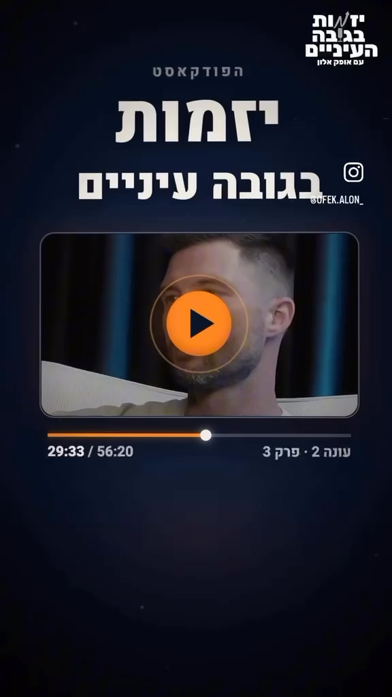

העיקרון לשחזור הוא לתכנן כל ויזואל כתשובה לשאלה “מה השתנה עכשיו במשמעות?”, ואז לבחור תנועה שנותנת לצופה להבין את השינוי. הפירוט, הצבע והטכניקה נבחרים אחר כך לפי החומר, הזהות והכלים הזמינים.

לשיטת בחירת הדיבור והסלמת המתח: [בחירת קטעים ודחיסה אסטרטגית](../../strategic-teaser-compression/references/content-compression-analysis.he.md).
